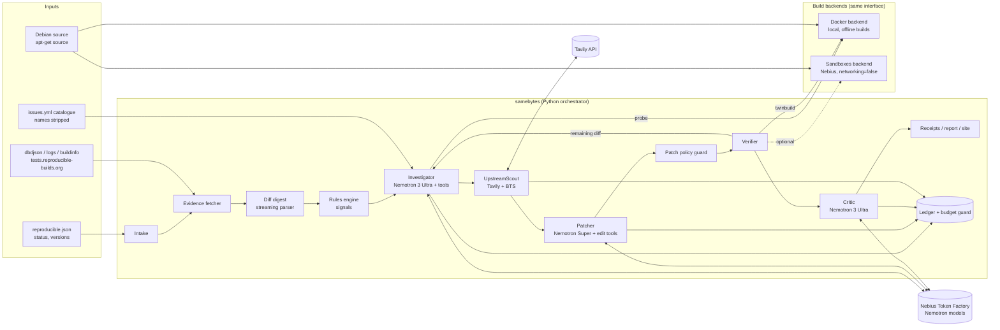

# SameBytes architecture

> How the system is put together: components, data flow, code layout, the frozen interfaces between Person A and Person B, data models, the state machine, storage, configuration and security.
> Companion docs: `AGENT_DESIGN.md` (the LLM side), `VERIFICATION_HARNESS.md` (the build side), `DATA_SOURCES.md` (inputs).

## 1. Design principles (each is a rule the code must follow)

1. **Proof over plausibility.** Nothing is "fixed" unless a twin build shows identical SHA-256 for every `.deb`, with an unchanged file list and passing tests. LLM opinions never override this.
2. **Deterministic first, LLM where it adds value.** Parsing, rules, policy, comparison and attribution are plain code. Models diagnose, write patches and explain.
3. **The agent runs experiments.** It tests hypotheses with `probe` and twin builds instead of guessing.
4. **Fix the cause, at the right layer.** If the cause is in a toolchain package, fix it there and verify all dependents. Normalizing outputs after the build is a last resort, and it is labelled as such.
5. **Everything is recorded.** Every model call, tool call, build and decision is written to the run directory. Reruns resume from cached stages.
6. **Backend-agnostic builds.** Docker today, Sandboxes when available, both behind one interface.
7. **Benchmark integrity is enforced in code** (`BENCHMARK_PROTOCOL.md` §6–7).

## 2. Component view



## 3. Repository layout

```
SameBytes/
├── AGENTS.md                  # handoff for coding agents (Cursor / Claude Code); CLAUDE.md points here
├── README.md                  # submission README (template in DEMO_AND_SUBMISSION.md §5)
├── LICENSE                    # MIT (already in repo)
├── pyproject.toml
├── .env.example  .gitignore  .gitattributes  .pre-commit-config.yaml  .secrets.baseline
├── .github/workflows/
│   ├── ci.yml                 # pytest + ruff + detect-secrets on every push/PR
│   ├── pages.yml              # site build + deploy from published/
│   └── verify.yml             # matrix twin build on GitHub runners, A and B on separate machines (D-033)
├── docker/
│   ├── Dockerfile             # samebytes-builder (Debian unstable toolchain)
│   └── sb-build               # entrypoint: applies variation profile, runs dpkg-buildpackage
├── src/samebytes/
│   ├── __init__.py
│   ├── cli.py                 # Typer app: doctor, fetch, twinbuild, probe, diagnose, fix, campaign, bench, report, site
│   ├── config.py              # pydantic-settings; reads env/.env
│   ├── models.py              # ALL shared pydantic models (frozen interface #2)
│   ├── ledger.py              # LedgerEntry writer, budget guard, cost summary
│   ├── runstore.py            # run directory layout, stage caching (frozen interface #3)
│   ├── llm/
│   │   ├── client.py          # Token Factory wrapper: retries, reasoning controls, usage → ledger, schema validation + repair
│   │   ├── replay.py          # record/replay index (SAMEBYTES_LLM_MODE), keyless demo + deterministic tests (D-032)
│   │   ├── registry.py        # model IDs, prices, per-role params
│   │   └── prompts/           # *.md prompt templates; hashed into run manifest
│   ├── evidence/
│   │   ├── debian.py          # reproducible.json, dbdjson, logs, buildinfo, history (build time)
│   │   ├── catalogue.py       # issues.yml loader + name stripping (agent-safe)
│   │   └── bts.py             # Debian BTS lookups (product mode only)
│   ├── digest/
│   │   ├── diffoscope.py      # JSON → DiffDigest (derivative filtering, caps)
│   │   ├── rules.py           # signal detectors
│   │   └── signature.py       # cluster signatures
│   ├── harness/
│   │   ├── base.py            # Backend protocol (frozen interface #1)
│   │   ├── profiles.py        # variation profiles (debian-ci, strict, none)
│   │   ├── docker_backend.py
│   │   ├── sandbox_backend.py
│   │   ├── fake_backend.py    # replays fixtures for tests / Person B
│   │   └── compare.py         # sha256, manifest, diffoscope
│   ├── agent/
│   │   ├── tools.py           # tool implementations + JSON schemas
│   │   ├── investigator.py
│   │   ├── patcher.py
│   │   ├── policy.py
│   │   ├── critic.py
│   │   ├── scout.py
│   │   ├── campaign.py        # clusters, rule reuse, dependents
│   │   └── orchestrator.py    # state machine
│   ├── report/
│   │   ├── receipt.py         # in-toto Statement v1
│   │   ├── markdown.py        # report.md, bug template, upstream PR draft
│   │   └── site.py            # static site generator (Jinja2)
│   └── bench/
│       ├── dataset.py  seal.py  leakguard.py  scorer.py  probe.py
├── bench/                     # datasets, SEAL.txt, run outputs (answer_key/ readable only by scorer)
├── site/                      # generated static site (deployed by GitHub Actions)
├── tests/
│   ├── fixtures/autoflake/    # recorded evidence + TwinBuildResult (Day 0, Person A)
│   └── test_*.py
└── docs/
```

`pyproject.toml` (pin major versions; generate a lock with `uv lock`):

```toml
[project]
name = "samebytes"
version = "0.1.0"
requires-python = ">=3.12"
license = {text = "MIT"}
dependencies = [
  "openai>=3.37",          # Token Factory is OpenAI-compatible
  "httpx>=0.28",
  "pydantic>=2.14",
  "pydantic-settings>=2.6",
  "typer>=0.15",
  "rich>=13.9",
  "pyyaml>=6.0",
  "tenacity>=9.0",
  "tavily-python>=0.8.5",
  "jinja2>=3.1",
  "python-dotenv>=1.2",
]
[project.optional-dependencies]
sandbox = ["contree-sdk>=0.3.6"]        # verify the PyPI name on the Sandboxes docs page
dev = ["pytest>=9.1", "ruff>=0.8", "pre-commit>=4.7", "detect-secrets==1.5.0"]
[project.scripts]
samebytes = "samebytes.cli:app"
[tool.ruff]
line-length = 100
```

Your current `requirements.txt` is a full `pip freeze` from Windows. Replace it with this `pyproject.toml` and a `uv.lock` generated inside WSL.

## 4. Frozen interface #1: build backends

```python
# src/samebytes/harness/base.py
from typing import Protocol
from samebytes.models import (PackageRef, EnvImage, TwinBuildRequest, TwinBuildResult,
                              ProbeRequest, ProbeResult)

class Backend(Protocol):
    name: str                                    # "docker" | "sandbox" | "fake"

    def prepare_env(self, pkg: PackageRef, *, toolchain_debs: list[str] = (),
                    refresh: bool = False) -> EnvImage:
        """Image with source unpacked at /src/<pkg>-<ver> and build-deps installed.
        Network ON only here. Cached by (pkg, version, toolchain_debs sha256s)."""

    def twinbuild(self, req: TwinBuildRequest) -> TwinBuildResult:
        """Two independent builds (A, B) from the same EnvImage with the profile's variations.
        Network OFF. Applies req.patchset to a fresh copy of the source in each build."""

    def probe(self, req: ProbeRequest) -> ProbeResult:
        """Run req.command twice (A env, B env) inside the EnvImage, offline, with timeout.
        Used by the agent to test hypotheses in seconds."""

    def build_toolchain_deb(self, src_pkg: PackageRef, patchset: "PatchSet") -> list[str]:
        """Build a patched toolchain package once (single build, tests on); return host paths of .debs."""
```

Rules every backend must honour:
- A and B never share a writable filesystem, process or `/tmp`.
- Both builds start from the same `EnvImage`. Its ID or digest goes into the receipt.
- No network during `twinbuild` or `probe`. Docker uses `--network none`; Sandboxes uses `networking.enabled=false`.
- Wall-clock timeout per build is `SAMEBYTES_BUILD_TIMEOUT_S` (default 1800).
- Output caps: logs are stored as files; the model only ever sees capped tails or grep results.

## 5. Frozen interface #2: data models (`src/samebytes/models.py`)

```python
from __future__ import annotations
from datetime import datetime
from enum import Enum
from typing import Literal
from pydantic import BaseModel, Field

class PackageRef(BaseModel):
    source: str                      # "autoflake"
    version: str                     # "2.4.0-1" (with epoch if any)
    suite: str = "unstable"
    arch: str = "amd64"
    @property
    def version_noepoch(self) -> str: return self.version.split(":", 1)[-1]

class Evidence(BaseModel):
    pkg: PackageRef
    ci_status: str                   # FTBR | reproducible | FTBFS | ...
    ci_build_seconds: int | None
    diffoscope_json_path: str | None
    diffoscope_txt_path: str | None
    build1_log_path: str | None
    build2_log_path: str | None
    buildinfo_path: str | None
    source_date_epoch: int | None    # from buildinfo Environment or changelog
    fetched_at: datetime
    origin: Literal["ci", "local"]   # benchmark/Track B may use locally generated evidence

class DiffLeaf(BaseModel):
    leaf_id: str                     # "L3"
    path: list[str]                  # ["python3-autoflake_2.4.0-1_all.deb","data.tar.xz","data.tar","./usr/share/man/man1/autoflake.1.gz","autoflake.1"]
    comparator: str | None           # diffoscope "comments"/type hints, e.g. "gzip", "ELF", "text"
    hunk: str                        # unified diff text, capped (default 60 lines)
    minus_lines: int
    plus_lines: int
    derivative: bool                 # md5sums, .changes Files, sizes … (consequences, not causes)
    truncated: bool

class DiffDigest(BaseModel):
    pkg: PackageRef
    leaves: list[DiffLeaf]           # ranked: non-derivative first, then by specificity
    total_leaves: int
    dropped_leaves: int
    bytes_in: int
    approx_tokens: int

class Variation(str, Enum):
    timezone="timezone"; time="time"; locale="locale"; user="user"; home="home"
    hostname="hostname"; domain="domain"; path="exec_path"; env="environment"
    umask="umask"; parallel="num_cpus"; build_options="build_options"; shell="bin_sh"
    kernel="kernel"; build_path="build_path"; fileordering="fileordering"
    randomness="randomness"; unknown="unknown"

class Signal(BaseModel):
    kind: str                        # e.g. "TZ_SHIFTED_SDE_DATE"
    variation: Variation
    confidence: float = Field(ge=0, le=1)
    leaf_id: str
    detail: str                      # human-readable, e.g. "2026-08-24 vs 2026-08-25, SDE=2026-08-24T21:..Z"
    catalogue_hints: list[str] = []  # issue names from the stripped catalogue

class Responsible(BaseModel):
    kind: Literal["package", "toolchain", "unknown"]
    package: str                     # source package that must change
    file: str | None                 # path relative to that package's source root (or installed path for toolchain)
    line_start: int | None = None
    line_end: int | None = None
    symbol: str | None = None

class Diagnosis(BaseModel):          # mirrors the JSON schema in AGENT_DESIGN.md §6.1
    summary: str
    varying_factor: Variation
    issue_types: list[str]           # ≤3, ranked; catalogue names or "novel:<slug>"
    responsible: Responsible
    causal_chain: list[str]          # factor → … → bytes in artifact
    evidence: list[str]              # leaf ids, probe ids, log line refs
    experiments: list[str]           # probe ids that confirmed/refuted
    fix_strategy: Literal["root_cause_package", "toolchain_fix", "build_system_flag",
                          "debian_rules_workaround", "normalization", "unknown"]
    confidence: float = Field(ge=0, le=1)

class UpstreamIntel(BaseModel):
    queries: list[str]
    debian_bugs: list[dict]          # {number, title, status, has_patch, url}
    upstream_refs: list[dict]        # {kind: commit|pr|issue|release, url, title, relevance}
    already_fixed_upstream: bool | None
    fixed_in_version: str | None
    recommendation: str              # how this changes the plan
    citations_verified: bool         # every URL cited was in search/extract results

class FileEdit(BaseModel):
    path: str
    old: str                         # exact text that must occur exactly once ("" for create)
    new: str

class PatchSet(BaseModel):
    target: str                      # "package" | "toolchain:<srcpkg>"
    edits: list[FileEdit]
    unified_diff: str                # computed by harness, never trusted from the model
    files_touched: list[str]
    lines_changed: int

class PatchCandidate(BaseModel):
    cand_id: str                     # "r1c2" = round 1, candidate 2
    description: str
    strategy_class: Literal["root_cause", "workaround", "normalization"]
    rationale: str
    patchset: PatchSet
    dep3_header: str                 # Description/Author/Bug-Debian/Forwarded/Last-Update

class PolicyResult(BaseModel):
    ok: bool
    violations: list[str]
    warnings: list[str]

class BuildOutcome(BaseModel):
    role: Literal["A", "B"]
    exit_code: int
    timed_out: bool
    wall_seconds: float
    debs: dict[str, str]             # filename → sha256
    manifest: dict[str, list[str]]   # filename → sorted file list (dpkg-deb -c names)
    log_path: str
    tests_ran: bool
    backend_op_id: str | None        # Sandbox operation id / docker container id

class TwinBuildRequest(BaseModel):
    pkg: PackageRef
    env: "EnvImage"
    profile: Literal["debian-ci", "strict", "none"] = "debian-ci"
    patchset: PatchSet | None = None
    nonce: str                       # uuid4; defeats any result caching, recorded in receipt
    disabled_variations: list[Variation] = []

class TwinBuildResult(BaseModel):
    req: TwinBuildRequest
    a: BuildOutcome
    b: BuildOutcome
    reproducible: bool               # same set of .debs and all sha256 equal
    manifest_equal: bool
    diffoscope_json_path: str | None
    diffoscope_txt_path: str | None

class EnvImage(BaseModel):
    backend: str
    ref: str                         # docker image id "sha256:…" or Sandbox image UUID
    pkg: PackageRef
    toolchain_overrides: list[dict] = []   # {kind: "overlay"|"deb", package, version, deb_sha256 | files:[{path, sha256_before, sha256_after}]}
    created_at: datetime

class ProbeRequest(BaseModel):
    env: EnvImage
    command: str
    cwd: Literal["source", "tmp"] = "source"
    timeout_s: int = 120
    vary_time: bool = False          # wrap B in faketime +398d
    probe_id: str

class ProbeResult(BaseModel):
    probe_id: str
    a_exit: int; b_exit: int
    a_stdout: str; b_stdout: str     # capped 8 KB each
    a_stderr: str; b_stderr: str     # capped 4 KB each
    identical: bool

class Verification(BaseModel):
    cand_id: str
    twin: TwinBuildResult
    policy: PolicyResult
    passed: bool                     # reproducible and manifest_equal and A tests passed and policy.ok

class LedgerEntry(BaseModel):
    ts: datetime
    run_id: str
    pkg: str | None
    stage: str                       # investigate | patch | critic | scout | condense | signature | probe-mem
    model: str
    prompt_tokens: int
    cached_tokens: int
    completion_tokens: int
    reasoning_tokens: int | None
    usd: float
    latency_s: float
    request_id: str | None
    ok: bool
    error: str | None = None
```

## 6. Orchestrator state machine (per package)

```mermaid
stateDiagram-v2
    [*] --> INTAKE
    INTAKE --> SKIPPED: not FTBR / build too long / blacklisted
    INTAKE --> EVIDENCE
    EVIDENCE --> BASELINE
    BASELINE --> NOT_REPRODUCED: twin build identical locally
    BASELINE --> BASELINE_FTBFS: build fails locally
    BASELINE --> DIGEST
    DIGEST --> RULES
    RULES --> RULE_FIX: verified rule matches (campaign reuse)
    RULES --> INVESTIGATE
    INVESTIGATE --> SCOUT: product mode
    INVESTIGATE --> PATCH: benchmark mode
    SCOUT --> PATCH
    PATCH --> VERIFY
    RULE_FIX --> VERIFY
    VERIFY --> CRITIC: a candidate passed
    VERIFY --> INVESTIGATE: none passed and round < 3 (remaining diff = new evidence)
    VERIFY --> FAILED: round == 3 or budget exhausted
    CRITIC --> FIXED: verdict accept
    CRITIC --> PATCH: verdict revise (once; Could, D-037)
    FIXED --> REPORT
    FAILED --> REPORT
    NOT_REPRODUCED --> REPORT
    BASELINE_FTBFS --> REPORT
    SKIPPED --> REPORT
    REPORT --> [*]
```

- **Stage caching.** Each stage writes `<stage>.json` with an `inputs_hash`. Rerunning skips stages whose inputs hash is unchanged (`--from <stage>` forces a rerun).
- **Budget checks:** before every model call, `ledger.check(run_budget, global_cap)` raises `BudgetExceeded`, which ends in `FAILED(reason=budget)`, never a crash.
- **Terminal statuses for the site:** `FIXED`, `FAILED`, `NOT_REPRODUCED`, `BASELINE_FTBFS`, `SKIPPED`. Every status has a reason string.

## 7. Frozen interface #3: run directory

```
runs/<run_id>/                      # run_id = YYYYMMDD-HHMMSS-<shortname>
├── manifest.json                   # git commit, mode, prompt hashes, model registry, profile, backend, caps
├── ledger.jsonl                    # LedgerEntry per model call (all packages)
└── <pkg>/
    ├── state.json                  # current state, history of transitions, terminal status + reason
    ├── evidence/                   # raw downloads (gz kept as-is) + evidence.json
    ├── digest.json  signals.json
    ├── llm/<stage>-<n>.json        # request (messages, tools, params) + response (content, reasoning, tool_calls, usage)
    ├── probes/<probe_id>.json
    ├── diagnosis.json  scout.json
    ├── candidates/<cand_id>/
    │   ├── patch.diff  candidate.json  policy.json
    │   └── twin/{A,B}/{build.log, *.deb list, sha256.txt, manifest.json}  twin/diffoscope.{json,txt}
    ├── baseline/twin/...
    ├── verification.json  critique.json
    ├── receipt.json                # in-toto Statement (VERIFICATION_HARNESS.md §8)
    ├── report.md  bug_draft.txt  upstream_pr_draft.md
    └── card.json                   # everything the site needs for this package
```

`.deb` files are *not* kept after hashing by default (`--keep-debs` to keep them), to save disk.

## 8. CLI surface

| Command | What it does |
|---|---|
| `samebytes doctor [--llm] [--docker] [--sandbox] [--tavily]` | Environment checks (`SETUP.md` §7) |
| `samebytes fetch <pkg>` | Download evidence and build the digest |
| `samebytes twinbuild <pkg> [--patch FILE] [--toolchain-deb DEB…] [--profile debian-ci\|strict] [--backend docker\|sandbox] [--batch FILE]` | Twin build only |
| `samebytes probe <pkg> -- <command>` | Manual hypothesis test |
| `samebytes diagnose <pkg>` | Through INVESTIGATE (and SCOUT in product mode) |
| `samebytes fix <pkg> [--mode product\|benchmark] [--max-rounds 3] [--budget-usd 1.0]` | Full pipeline with a live Rich view |
| `samebytes campaign <toolchain-pkg> [--members FILE] [--parallel 2]` | Fix once, verify all dependents |
| `samebytes bench build\|seal\|run\|score\|probe --track A\|B` | Benchmark (`BENCHMARK_PROTOCOL.md`) |
| `samebytes map [--batch]` | Signature pass over all FTBR packages |
| `samebytes report <run_id>` and `samebytes site build\|serve` | Outputs |
| `samebytes cost [--run RUN]` | Ledger summary: by stage, by model, cached-token savings |
| `samebytes replay <published/run-dir>` | Re-run the recorded agent session with no network and no key (live view, labelled REPLAY) |
| `samebytes ci-build --pkg P --role A\|B [--patch FILE]` | One role of a twin build; used by `verify.yml` on GitHub runners (`VERIFICATION_HARNESS.md` §14) |
| `samebytes fix <pkg> --blind` | Redact the catalogue entry that names the cause (`AGENT_DESIGN.md` §3.1.1) |

The `fix` live view (Rich) shows the current state, the model and stage in use, the last tool call, tokens (with the cached count) and $ so far. **This is what the video shows.**

## 9. Configuration (`config.py`, environment variables)

| Variable | Default | Meaning |
|---|---|---|
| `NEBIUS_API_KEY` | — (required) | Token Factory key (also used by Sandboxes) |
| `NEBIUS_PROJECT_ID` | — | Needed for Sandboxes |
| `TAVILY_API_KEY` | — | Scout; absent means the scout is skipped with a warning |
| `SAMEBYTES_BASE_URL` | `https://api.tokenfactory.nebius.com/v1/` | |
| `SAMEBYTES_MODEL_INVESTIGATOR` | `nvidia/Nemotron-3-Ultra-550b-a55b` | |
| `SAMEBYTES_MODEL_PATCHER` | `nvidia/nemotron-3-super-120b-a12b` | Bake-off may switch it to `nvidia/Nemotron-3.5-Super-VL` |
| `SAMEBYTES_MODEL_CRITIC` | `nvidia/Nemotron-3-Ultra-550b-a55b` | |
| `SAMEBYTES_MODEL_FAST` | `nvidia/Nemotron-3_5-Lightning` | Condense, scout queries, signatures (bake-off vs Nano) |
| `SAMEBYTES_MODE` | `product` | `benchmark` disables Tavily and BTS and enforces the denylists |
| `SAMEBYTES_LLM_MODE` | `live` | `record` / `replay`: keyless demo and deterministic tests (`AGENT_DESIGN.md` §2.1.1) |
| `SAMEBYTES_REDACT_ISSUES` | empty | Catalogue names removed from the prompt; `--blind` also drops entries naming the tool under test (`AGENT_DESIGN.md` §3.1.1) |
| `SAMEBYTES_BACKEND` | `docker` | `sandbox` once access is granted |
| `SAMEBYTES_BUILDER_IMAGE` | `samebytes-builder:2026-10-25` | |
| `SAMEBYTES_MAX_USD` | `30` | Global hard cap across all runs (the ledger sums all of `runs/`) |
| `SAMEBYTES_RUN_BUDGET_USD` | `1.0` | Per package |
| `SAMEBYTES_BUILD_TIMEOUT_S` | `1800` | Per single build |
| `SAMEBYTES_MAX_CI_BUILD_S` | `600` | Intake skips packages whose CI build is slower (override with `--force`) |
| `SAMEBYTES_PARALLEL_BUILDS` | `2` | Local concurrency |
| `SAMEBYTES_LLM_CONCURRENCY` | `4` | Stays well under the 60 RPM base limit |

## 10. Cross-cutting concerns

- **Retries:** `tenacity` with exponential backoff and jitter on 429/5xx/timeouts. It honours `Retry-After`; maximum 5 attempts. Timeouts are 300 s for Ultra and 120 s for the others.
- **Logging:** `rich` console plus a JSON log per run. Secrets are never logged; the client redacts `Authorization` headers.
- **Idempotence:** env images are keyed by `(pkg, version, sha256(toolchain_debs))`. Evidence is keyed by URL plus ETag.
- **Concurrency:** builds use a process pool of size `SAMEBYTES_PARALLEL_BUILDS`; LLM calls use an asyncio semaphore. Never run two twin builds of the same package at once.
- **Disk:** a twin build uses about 2–6 GB of temporary space. `docker system df` is checked in `doctor`. The `samebytes gc` command prunes env images older than N days.

## 11. Security model
- **Untrusted code runs only in containers or VMs:**
  - build users are not root;
  - `--network none` (after deps are installed), `--pids-limit 4096`, `--memory`, `--cpus`;
  - no Docker socket mount, no host home mount;
  - the source is mounted read-only and copied into the container's build path.
- **The models never get a raw shell on the host.** Tools are fixed Python functions. `probe` runs inside the offline env container as the build user, with a timeout and capped output.
- **Prompt injection:** source files, logs and web pages are *data*.
  - Every prompt states it.
  - Tools can't send data anywhere: no network tool for the model except the orchestrator-driven scout, which runs with domain filters.
  - The policy guard and the proof don't depend on model honesty.
- **Secrets:** `.env` only. Never passed into containers. The `detect-secrets` pre-commit hook stays on.
- **Upstream actions** (bugs, PRs, emails) are never automated. Drafts only; a human sends them.
