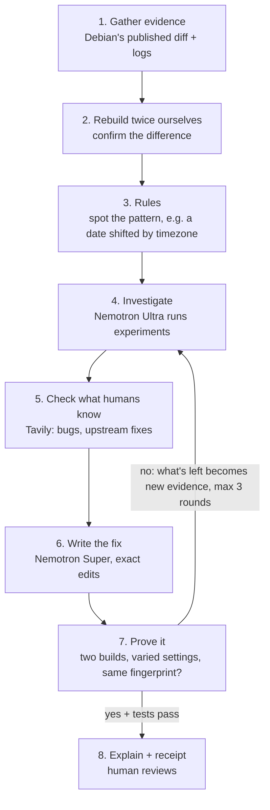

# SameBytes explained in plain language

> For the teammate, and for anyone new to the project. The technical version is in `PROJECT_BRIEF.md`.

## The bakery analogy

- **Source code** is the recipe.
- **Building** (compiling) is baking.
- **The binary** (the program file) is the cake.

People download cakes, not recipes. To check a cake wasn't tampered with, you bake the same recipe yourself and compare. We compare **fingerprints** (SHA-256 hashes): a short code calculated from every byte of a file. Change one byte and the fingerprint changes completely.

The check only works if the same recipe always gives the same cake. That property is a **reproducible build**. Usually it doesn't hold, because the baker stamps each cake with things like:

- the time it was baked (timestamps, e.g. inside gzip files);
- the kitchen's address (the build folder path);
- the baker's name (username, hostname);
- the order ingredients were grabbed (file listing order);
- the language on the label (locale, timezone);
- how many helpers there were (CPU count);
- random shuffles (hash seeds).

The program works fine, but every build's fingerprint is different, so comparing tells you nothing.

## Why it matters

- **SolarWinds (2020):** attackers hacked the build server and injected code during the build. The source was clean; the product wasn't.
- **xz backdoor (2024):** part of the malicious code was only in the release files, not in the public source.

Independent rebuild-and-compare catches both, but only if builds are reproducible. Reproducible builds mean you don't have to trust the builder.

## Who has the problem

- **Debian**, which Ubuntu and many others are built on. Since May 2026, Debian blocks new unreproducible packages, and packages that stopped being reproducible, from reaching the next release.
  - About 1,150 packages are unreproducible; about 620 have no known cause.
  - Only about 9 volunteers actively investigate.
- **Package maintainers**, who get blocked and don't know why.
- **Every company shipping software in Europe**, which faces the Cyber Resilience Act (full enforcement December 2027).
- **Other ecosystems:** Arch, Fedora, PyPI (only 15–19% of rebuilds are identical), npm, containers, firmware.

## Detect, fix, verify: which part we do

1. **Detecting** ("is it reproducible?"): already solved by Debian's test servers. We use their results.
2. **Fixing** ("why not, and what change fixes it?"): today this is done by hand by experts. **This is our product.**
3. **Verifying** ("is the fix real?"): we build twice on two fresh machines and compare fingerprints. This is our proof, so nobody has to trust the AI.

## "Isn't this a one-time job?"

No:

- Software keeps changing, so new versions keep breaking reproducibility. That's why Debian specifically blocks *regressions*.
- Debian is only the test track with an answer key; the same problem exists everywhere software is built.
- The lasting product is a **Dependabot-style guard**: it checks every release and, when reproducibility breaks, opens a pull request with a proven fix.

## The pipeline

Walkthrough with our real flagship, `autoflake`:

1. **Gather evidence.** Debian's diff shows only one real difference: the date in the man page is `2026-08-24` in one build and `2026-08-25` in the other.
2. **Rebuild twice ourselves.** We confirm it: the two fingerprints differ on our machine too.
3. **Rules.** A rule notices both dates sit next to the package's fixed "official date" (`SOURCE_DATE_EPOCH`). One day apart is exactly what you get when two builds run in timezones 26 hours apart, so the tool is using local time.
4. **Investigate (Ultra).** The agent searches the build log for who wrote the man page, finds a shared tool (`argparse-manpage`), works out which Debian package ships it, and reads its code. Then it **runs an experiment**: the tool's date function under both test environments. Two different dates, so the cause is confirmed. The real bug: a line that tries to load "UTC" always fails silently, so the tool falls back to local time.
5. **Check what humans know (Tavily).** Debian already had a patch, but it's stuck, because that version doesn't build on the newest Python. Upstream is still broken.
6. **Write the fix (Super).** A two-line change to the tool, plus the small fix for the newer Python.
7. **Prove it.** Build the fixed tool, then build autoflake twice with it: identical fingerprints, tests pass. Repeat for all 13 packages that use the tool.
8. **Explain and receipt.** A plain-language explanation, a receipt with all the hashes, and drafts for Debian and upstream. A human reviews and sends.

## Model roles

- **Ultra:** the senior detective. Reads clues, runs experiments, names the culprit.
- **Super:** the careful programmer who writes the smallest correct fix.
- **Lightning / Nano:** the fast assistants. They write search queries, summarize, and sort a thousand cases into groups.
- **The twin build:** the judge. It doesn't care what any model says; the fingerprints match or they don't.

## Glossary

- **Debian package / `.deb`:** an installable bundle of software for Debian.
- **Source package:** the recipe: the original code plus Debian's `debian/` folder of build instructions.
- **`debian/rules`:** the main build script. Many fixes land here.
- **`.buildinfo`:** a record of the exact environment a package was built in.
- **Upstream:** the original authors of the software, as opposed to Debian, which repackages it.
- **`SOURCE_DATE_EPOCH`:** a standard fixed date that tools should write instead of "now".
- **Hash / SHA-256:** a file fingerprint.
- **Variation:** one thing deliberately changed between the two builds.
- **reprotest:** the tool that builds twice with variations.
- **diffoscope:** the tool that shows exactly where two outputs differ.
- **disorderfs / FUSE:** a filesystem that scrambles file order to expose ordering bugs. It needs a Linux feature (FUSE) that may not be available in sandboxes.
- **tests.reproducible-builds.org:** Debian's stress test, which builds twice with deliberate variations. Our demo targets this.
- **reproduce.debian.net:** rebuilds Debian's real published packages exactly; this is what blocks releases. A future target for us.
- **Token Factory:** Nebius' service that hosts AI models (pay per token) and runs Sandboxes.
- **Sandbox:** a fresh, isolated virtual computer for one job.
- **Image UUID:** the ID of an exact starting snapshot for a sandbox.
- **Nemotron:** NVIDIA's family of open AI models.
- **Tavily:** a search engine built for AI agents (owned by Nebius).

- **Toolchain package:** a tool other packages use while building (like argparse-manpage, which writes man pages). One bug in it can break many packages.
- **Probe:** our agent's experiment. It runs one command under both test environments and compares the outputs, in seconds.
- **Receipt:** a JSON record of what was built, where, how, and the resulting fingerprints.

## 30-second pitch (original; the current version is in `PROJECT_BRIEF.md`)

"Build the same code twice and you usually get different files, because things like the time and folder name sneak in. That breaks the main way to check software wasn't tampered with. Debian now blocks packages with this problem, and only a handful of volunteers can fix them. SameBytes reads the evidence, finds the cause, writes the fix, and proves it by building on two fresh Nebius sandboxes and showing identical fingerprints. NVIDIA Nemotron Nano summarizes, Ultra diagnoses, and Super writes the code."
